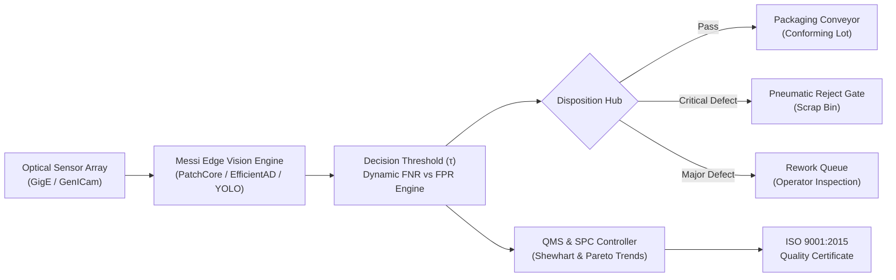

# Messi: AI-Powered Industrial Visual Inspection & Quality Management System

[](https://github.com/muzeemreniman113-arch/AI-Powered-Industrial-Visual-Inspection-and-Quality-Management/actions/workflows/deploy.yml)
[](#standards-compliance)
[](#standards-compliance)
[](#standards-compliance)
[](#design-system)

**Messi** is an enterprise-grade Automated Optical Inspection (AOI 4.0) and Quality Management System (QMS) engineered for semiconductor fabrication, high-speed printed circuit board (PCB) assembly, metallurgical rolling mills, electric motor commutator molding, and solar photovoltaic wafer manufacturing.

Designed with a high-contrast **Light Industrial Theme** for factory control stations and engineering cleanrooms, Messi consolidates real-time optical anomaly detection with 26+ standardized industrial benchmarks, Statistical Process Control (SPC) Shewhart tracking, Pareto defect analytics, and cryptographic ISO 9001 quality certificates.

---

## 🌟 Live Features & System Architecture



### 1. Real-Time Optical Inspection Console (AOI 4.0)
- **Multi-Line Station Switcher**:
  - **Line A04**: SMT PCB Assembly (Linear Scan CCD at 48 px/mm).
  - **Line S12**: Hot-Rolled Continuous Strip Mill (Dark-Field Specular CMOS).
  - **Line C08**: Commutator Molding Cell (Rotary Telecentric Lens).
  - **Line E01**: TOPCon Photovoltaic Wafer Cell (NIR Electroluminescence).
- **Interactive Defect Overlays**:
  - Dynamic Anomaly Bounding Box localizer with sub-millimeter area measurement ($mm^2$).
  - Full-spectrum Jet/Turbo heatmap segmentation masks.
  - Golden Reference differential comparator ($\Delta$ Pixel Discrepancy).
  - Interactive 2.5x / 5x precision inspection magnifier loupe with crosshair reticle.
- **Dynamic Decision Threshold ($\tau$) Controller**:
  - Real-time adjustment of detection sensitivity with immediate mathematical recalculation of **False Negative Rate (FNR)** vs **False Positive Rate (FPR)** tradeoffs.

### 2. Master Industrial Datasets Intelligence Hub
Implements the complete benchmark catalog from `master-industrial-visual-inspection-datasets.md`:
- **26 Master Benchmarks Included**:
  - `MVTec AD`, `VisA`, `Real-IAD`, `DeepPCB`, `NEU Surface Defect`, `Severstal Steel`, `DAGM 2007`, `KolektorSDD`, `KolektorSDD2`, `MVTec 3D-AD`, `MVTec LOCO AD`, `BTAD`, `MPDD`, `Magnetic Tile (MTD)`, `PKU-Market-Phone`, `PKU-GoodsAD`, `InsPLAD (Fault)`, `VISION V1 / V2`, `MAD (Sim/Real)`, `Defect Spectrum`, `elpv-dataset`, `Real3D-AD`, `Anomaly-ShapeNet`, `RSDDs`, `Insulator DataSet`, and `CrackForest`.
- **Search & Multi-Facet Filtering**: Filter by manufacturing sector, supervision level (Unsupervised, Strong, Weak), modality (2D RGB, Grayscale, 3D Point Cloud, Electroluminescence), and licensing.
- **Direct Export**: One-click export to structured JSON or CSV format.
- **Interactive Specification Drawer**: In-depth modal with split statistics, defect taxonomy breakdown, and direct academic/repository links.

### 3. Quality Management System (QMS) & Statistical Process Control (SPC)
- **Shewhart Control Chart ($X\text{-bar}$)**: Real-time First Pass Yield (FPY) trend monitored against Upper Control Limit (UCL = 99.9%), Lower Control Limit (LCL = 98.5%), and target mean.
- **Pareto 80/20 Defect Analysis**: Bar distribution of defect frequencies paired with cumulative percentage curves.
- **Live Traceability Stream**: High-frequency inspection log with batch serialization (`LOT-2026-XXXXX`), operator signoffs, millisecond latency timers, and defect codes.
- **Data Export**: Full export of audit records to CSV and JSON.

### 4. Interactive Defect Analysis Lab (Upload Sandbox)
- Operators can upload custom plant imagery or load pre-calibrated specimens.
- Real-time client-side edge tensor simulation extracts defect bounding boxes and computes spatial areas.

### 5. Edge AI Model Zoo & Hardware Deployment Matrix
- Comparative throughput and latency benchmarks across **NVIDIA Jetson AGX Orin**, **Intel Xeon Gold OpenVINO**, **Dual RTX 4090 Industrial PC**, and **Coral Edge TPU**.
- Architecture overviews of **PatchCore**, **EfficientAD**, **YOLOv10-Defect**, and **PointNet3D**.

### 6. Compliance & Auditing (ISO 9001 / IATF 16949 / IPC-A-610G)
- Embedded generator for cryptographic **Certificates of Optical Inspection Quality**.
- Dedicated print layout configured for ISO 9001:2015 Clause 8.6 release signoffs.

---

## 📐 Mathematical Formulation of Factory Quality Metrics

| Metric | Formulation | Operational Priority & Impact |
| :--- | :--- | :--- |
| **False Negative Rate (FNR)** | $\text{FNR} = \frac{\text{FN}}{\text{TP} + \text{FN}}$ | **Primary Objective (Minimize $\to 0$)**: Escaped defects shipped to customers lead to catastrophic field failures and automotive warranty recalls. |
| **False Positive Rate (FPR)** | $\text{FPR} = \frac{\text{FP}}{\text{FP} + \text{TN}}$ | **Throughput Constraint (Keep $< 1.2\%$)**: False alarms unnecessarily halt high-speed lines for human verification. |
| **Intersection over Union (IoU)** | $\text{IoU} = \frac{\|G \cap P\|}{\|G \cup P\|}$ | **Defect Sizing**: Measures overlap between detected bounding contours and metallurgical ground truth. |
| **Dice Similarity Coefficient** | $\text{Dice} = \frac{2\|G \cap P\|}{\|G\| + \|P\|}$ | **Crack Segmentation**: Standard metric for fine hairline fissures (Severstal Steel & KolektorSDD). |

---

## 🚀 Deployment Guide on GitHub Pages

This repository is pre-configured for automated continuous deployment to **GitHub Pages** via GitHub Actions.

### Method 1: Automated GitHub Actions (Recommended)
1. Push your repository to GitHub:
   ```bash
   git add .
   git commit -m "feat: Deploy Messi Industrial Inspection Platform"
   git push origin main
   ```
2. Navigate to your repository on GitHub:
   - Go to **Settings** > **Pages**.
   - Under **Build and deployment** > **Source**, select **GitHub Actions**.
3. The included workflow `.github/workflows/deploy.yml` will automatically build and deploy the platform to:
   ```
   https://muzeemreniman113-arch.github.io/AI-Powered-Industrial-Visual-Inspection-and-Quality-Management/
   ```

### Method 2: Standard Branch Deploy
1. In repository **Settings** > **Pages**:
   - Set **Source** to **Deploy from a branch**.
   - Select branch **main** and folder **`/ (root)`**.
   - Click **Save**.

---

## 📂 Repository Structure

```text
├── .github/
│   └── workflows/
│       └── deploy.yml              # Automated GitHub Pages CI/CD workflow
├── assets/
│   ├── css/
│   │   └── style.css               # Light industrial theme & print certificate stylesheet
│   └── js/
│       ├── app.js                  # Main UI coordinator & event router
│       ├── datasets-data.js        # Structured data for 26+ industrial datasets
│       ├── inspection-engine.js    # Canvas optical inspection & CV simulation engine
│       └── qms-engine.js           # SPC Shewhart, Pareto & QMS audit stream
├── docs/
│   └── master-industrial-visual-inspection-datasets.md # Source benchmark dataset directory
├── .nojekyll                       # Bypass Jekyll processing on GitHub Pages
├── index.html                      # Single-page enterprise inspection application
└── README.md                       # Comprehensive platform documentation
```

---

## 📜 Standards & Compliance Readiness

- **ISO 9001:2015**: Clause 8.6 (Release of Products and Services) & Clause 8.7 (Control of Nonconforming Outputs).
- **IATF 16949:2016**: Automotive QMS statistical process control & defect escape prevention.
- **IPC-A-610G**: Acceptability of Electronic Assemblies (Class 1, 2, and 3).
- **ASTM E1444 / E1444M**: Standard Practice for Magnetic Particle and Surface Examination.

---

## 📄 License

- Software & Platform Code: [MIT License](LICENSE)
- Datasets & Benchmark Citations: Respective licenses per host institution (CC BY-NC-SA 4.0, MIT, Academic Research Licenses detailed in the Dataset Hub).
